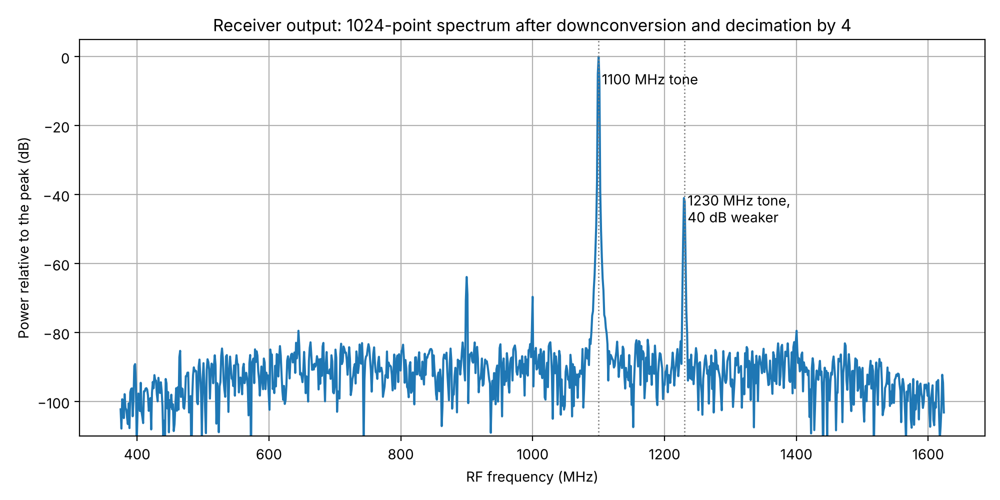
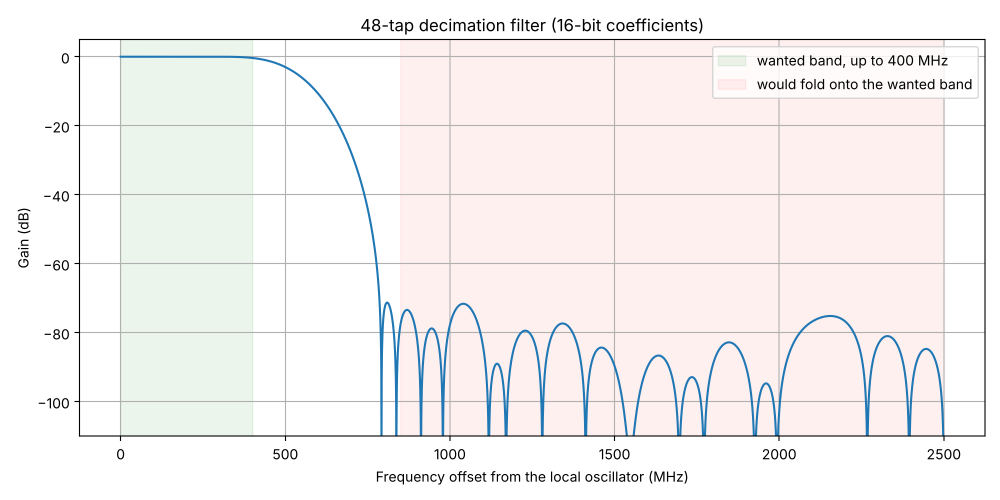
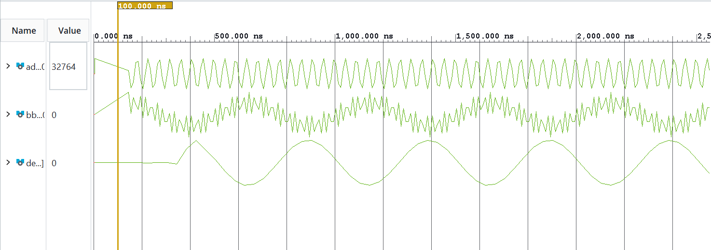

# Digital Receiver in Verilog: Downconverter, Decimating FIR and Mixed-Radix FFT

A digital receiver written in Verilog and checked in simulation. It takes real
ADC samples, shifts the wanted band down to 0 Hz, filters and decimates it,
computes a 1024-point FFT, finds the strongest signal and sends the result out
as a packet. A Python script plays the host PC, decodes the packet and reports
the signal's frequency.

Every block is checked value for value against an integer Python model, and
the design runs in both Icarus Verilog and the Vivado simulator.



*The receiver's own output for a 1100 MHz tone, a second tone 40 dB weaker at
1230 MHz, and noise, as a 14-bit ADC would deliver them.*

## Background

The DDS and the 1024-point FFT were developed during a research internship at
the Centre for Airborne Systems (CABS), DRDO, Bengaluru, under the guidance of
Dr. Gopi Kumar Nasanna, as the signal-processing core of a receiver planned for
a Xilinx ZCU208 RFSoC board. Due to the unavailability of the board, the simulation was carried out on ZedBoard

## Signal chain

```
RF test tone (DDS)  ->  ADC model, 14 bits          tb/        simulation only
                              |
                              v   real samples, 5 GSPS
                        ddc_mixer                   multiply by a 1000 MHz complex oscillator
                              |   I/Q, 5 GSPS
                        fir_decimator               48-tap low-pass, keep 1 sample in 4
                              |   I/Q, 1.25 GSPS
                        fft_frame_capture           Hann window, 1024 samples, FFT
                              |   1024 bins, 1.22 MHz apart
                        peak_detector               strongest bin and its two neighbours
                              |
                        result_packetizer           52-byte packet, one byte per clock
                              |
                        python/host.py              decode, estimate the frequency
```

| Block | File | What it does |
|---|---|---|
| DDS | `rtl/dds_iq_source.v` | 32-bit phase accumulator, 1024-entry sine table, 16-bit cosine and sine outputs |
| Mixer | `rtl/ddc_mixer.v` | multiplies ADC samples by the oscillator, giving I and Q centred on 0 Hz |
| FIR decimator | `rtl/fir_decimator.v` | removes what would otherwise fold onto the wanted band, then drops 3 samples in 4 |
| Frame capture | `rtl/fft_frame_capture.v` | windows 1024 samples, runs the FFT, records which samples the frame holds |
| FFT | `rtl/custom_fft_1024.v`, `dit_stage*.v`, `radix*_butterfly.v` | 1024-point mixed-radix FFT |
| Peak detector | `rtl/peak_detector.v` | power of each bin, largest one, and the bins beside it |
| Packetiser | `rtl/result_packetizer.v` | packs the result with a checksum; valid/ready/last byte stream |
| Receiver | `rtl/digital_receiver.v` | connects the blocks above |
| ADC model | `tb/adc_model.v` | keeps the top 14 bits of a 16-bit sample |

`rtl/custom_fft_8192_wrapper.v` and `rtl/dds_fft_8192_system.v` are the
original FFT-only test setup (a DDS feeding 8 FFT frames directly).

## Numbers for the test setup

| | |
|---|---|
| ADC sample rate modelled | 5 GSPS, 14 bits |
| Local oscillator | 1000 MHz |
| Rate after decimation | 1.25 GSPS, complex |
| RF range covered | 375 to 1625 MHz |
| Filter | within 0.4 dB over ±400 MHz; at least 71 dB rejection of everything that folds onto that band |
| FFT bin spacing | 1.22 MHz |
| Test tone | 1100 MHz, which lands in bin 82 |
| One frame | 9,992 clock cycles: 4,096 to capture, the rest to compute |



The front end in Vivado's simulator, for the 1100 MHz test tone:



*Top: ADC samples. Middle: mixer output (`bb_i`), a 100 MHz wave with the
unwanted 2100 MHz component riding on it. Bottom: filter output (`dec_i`), the
clean 100 MHz wave at a quarter of the sample rate. The simulation clock is
10 ns per sample, so the 500 ns period seen here is 50 samples, which is
100 MHz at 5 GSPS.*

## Results

`python python/verify.py` prints:

```
fft tone    equals the model: True   vs numpy.fft: 80.7 dB   PASS
fft random  equals the model: True   vs numpy.fft: 80.3 dB   PASS
dds to fft  peak bin per frame: [20, 20, 20, 20, 20, 20, 20, 20]   PASS
rx dds      equals the model: True   frequency 1100.000 MHz, worst error 9 Hz   PASS
rx file     equals the model: True   frequency 1100.000 MHz, worst error 44 Hz   PASS
```

- **FFT.** All 8,192 outputs equal the integer model, for a tone and for random
  data. Against floating-point `numpy.fft.fft` the error is about 80 dB below
  the signal; it comes from the 16-bit twiddle factors and the truncation after
  each multiplication.
- **Receiver.** For both tests, every spectrum value and every packet byte of
  four consecutive frames equals the model.
  - *rx dds*: a DDS generates the 1100 MHz tone and the ADC model quantises it.
  - *rx file*: ADC samples come from a file holding the two tones and noise
    shown in the plot at the top.
- **Frequency estimate.** The peak bin alone is accurate to 1.22 MHz. Using the
  two neighbouring bins, the host estimates 1100 MHz to within 9 Hz for the
  clean tone and 44 Hz with noise.
- **Dynamic range in the plot.** The weak tone is clearly visible 41 dB below
  the strong one, and the noise floor is about 90 dB down. Two small spurs
  remain: one 64 dB down at 900 MHz, caused by the oscillator's 1024-entry sine
  table, and one 70 dB down at the oscillator frequency, caused by truncation
  in the mixer.

## How the FFT works

It is a decimation-in-time FFT built from four stages (1024 = 4 × 4 × 8 × 8).
Each stage combines smaller DFTs into larger ones:

| Stage | Radix | Butterflies | Builds | Twiddle factors | Word length (in → out) |
|---|---|---|---|---|---|
| 1 | 4 | 256 | 256 DFTs of 4 points | none | 16 → 20 bits |
| 2 | 4 | 256 | 64 DFTs of 16 points | W16, constants in the code | 20 → 20 bits |
| 3 | 8 | 128 | 8 DFTs of 128 points | W128, `mem/twiddle128_*.mem` | 20 → 23 bits |
| 4 | 8 | 128 | 1 DFT of 1,024 points | W1024, `mem/twiddle_*.mem` | 23 → 26 bits |

- Input branch *m* of a butterfly is multiplied by its twiddle factor before the
  butterfly. Branch 0 needs no multiplier.
- Twiddle factors are 16-bit Q15 values. A product is shifted right by 15 bits.
- The radix-4 butterfly needs only additions; the radix-8 butterfly needs two
  multiplications by 1/√2.
- The output is not scaled, which is why it grows to 26 bits.
- Each stage stores its 1,024 inputs, computes one butterfly per clock cycle,
  then streams its results to the next stage, bin 0 first.

## Result packet

52 bytes, most significant byte first:

| Bytes | Field |
|---|---|
| 0–3 | magic number `DRX1` |
| 4–7 | frame number |
| 8–15 | timestamp: index of the frame's first sample (at the decimated rate) |
| 16–19 | oscillator phase increment (frequency ÷ sample rate × 2³²) |
| 20–21 | flags; bit 0 = window applied |
| 22–23 | peak bin, 0 to 1023 |
| 24–31 | power of the peak bin |
| 32–39 | power of the bin before it |
| 40–47 | power of the bin after it |
| 48–51 | checksum: sum of the twelve 32-bit words above |

`python/host.py` checks the magic number and checksum and converts the fields
to a frequency:

```
> python python/host.py build/rx_file/rx_packets.txt
frame 0: first sample      0, peak bin   82, RF frequency 1100.000 MHz
frame 1: first sample   2498, peak bin   82, RF frequency 1100.000 MHz
...
```

## Run it

Needs Python 3.9 or newer and [Icarus Verilog](https://steveicarus.github.io/iverilog/).

```
pip install -r requirements.txt           # NumPy and Matplotlib
conda install -c conda-forge iverilog     # one way to get Icarus Verilog (Windows, Linux, macOS)
```

On Linux, `sudo apt install iverilog` also works. Then:

```
python python/verify.py             # simulate and check everything; output goes to build/
python python/host.py build/rx_file/rx_packets.txt    # decode the packets the receiver sent
python python/plot_receiver.py      # receiver spectrum and filter response, into docs/
python python/plot.py               # plots for the FFT-only test, into docs/
python python/generate_tables.py    # rewrites the tables in mem/
```

`verify.py` takes about 15 to 30 seconds and prints the five lines shown under
Results.

To use the Vivado simulator instead:

1. Add `rtl/` as design sources, and `tb/` plus the files in `mem/` as
   simulation sources.
2. Set `tb_digital_receiver` as the simulation top.
3. In the Tcl console: `set_property verilog_define {DDS_SOURCE} [get_filesets sim_1]`.
   This selects the DDS as the signal source. Without it the testbench reads
   `adc_samples.mem`, which `verify.py` writes into `build/rx_file/`.
4. Set the simulation run time to `-all`. The run ends by itself after four packets.

## Layout

```
rtl/      the design
tb/       testbenches and the ADC model
mem/      sine table, twiddle factors, window, filter coefficients, FFT test tone
python/   verify.py, model.py (integer model), host.py (packet decoder), plots, table generator
docs/     plots and a waveform screenshot
requirements.txt   Python packages
```

## Limits

- **Simulation only.** Nothing here has been synthesised, timed or run on a
  board. The ADC is a model.
- **Not real time.** One sample per clock would need a 5 GHz clock; real RFSoC
  designs process several samples in parallel per clock, which this does not.
  The filter also adds all 48 products in a single clock cycle.
- **Snapshots, not a continuous stream.** The FFT works on one frame at a time,
  so the receiver uses 4,096 of every 9,992 ADC samples. The timestamp in each
  packet says which.
- **One signal per frame.** The packet reports only the strongest bin.
- **Headroom.** The FFT word lengths are sized for a complex input of magnitude
  up to 32,767. The receiver path stays within that; the FFT on its own can
  overflow if I and Q are both driven to full scale.

## Not built yet

A parallel (multi-sample-per-clock) front end, a pipelined FFT for continuous
data, detection of several signals per frame, the processor-side software and
the UDP/Ethernet link that would carry the packets, and bring-up on hardware.

## Acknowledgements

- **Centre for Airborne Systems (CABS), Defence Research and Development
  Organisation (DRDO)**, where the DDS and FFT work was carried out.
- **Dr. Gopi Kumar Nasanna**, our guide at CABS, for the problem statement, the
  proposed receiver architecture and his guidance throughout the internship.
